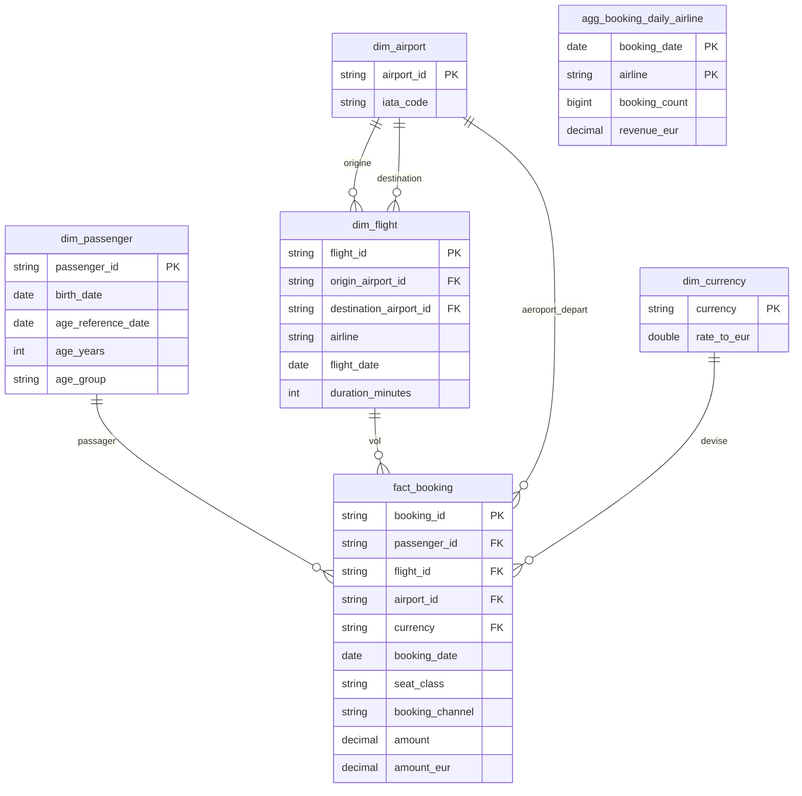

# Exploration et choix de modélisation

## Périmètre réalisé

L'exploration et les couches Bronze, Silver et Gold sont réalisées. Le pipeline
produit les dimensions, le fait réservation et une agrégation quotidienne par
compagnie. Les bonus Dagster et SCD2 ne sont pas implémentés.

## Observations sur les sources

Source : [tp-polytech-dataset](https://github.com/kevinl75/tp-polytech-dataset).
L'exploration ci-dessous porte sur les CSV locaux actualisés après la modification
du dépôt source. Elle compare les cinq fichiers de `init/` avec ceux des 1er, 2 et
3 septembre 2025, soit 20 fichiers. La validation Silver utilise ensuite les
155 fichiers de l'initialisation et du mois complet.

| Source | Clé unique observée | Init | 01/09 | 02/09 | 03/09 | Nature du fichier |
| --- | --- | ---: | ---: | ---: | ---: | --- |
| Aéroports | `airport_id` | 80 | 80 | 80 | 80 | État complet |
| Vols | `flight_id` | 420 | 420 | 421 | 422 | État complet |
| Passagers EN | `passenger_id` | 900 | 911 | 913 | 923 | État complet |
| Passagers FR | `id_passager` | 900 | 905 | 911 | 917 | État complet |
| Réservations | `booking_id` | 480 | 1 138 | 1 534 | 1 184 | Historique initial, puis nouveautés quotidiennes |

- Les aéroports ne changent pas dans cet échantillon. Le README source annonce
  un ajout et une correction sur le mois, sans suppression.
- Les vols présentent un ajout et une disparition le 1er septembre, deux ajouts
  et une disparition le 2, puis un ajout le 3.
  Un nombre de lignes stable ne signifie donc pas une absence de changements.
- Les passagers croissent chaque jour ; une adresse e-mail EN et un nom FR sont
  corrigés le 2. Sept passagers ont disparu à la fin du mois.
- Aucun doublon de clé dans les fichiers examinés, aucun chevauchement des IDs
  passagers EN/FR, et aucun ID de réservation répété entre ces quatre périodes.
- Chaque réservation examinée référence un passager, un vol et un aéroport
  présents dans les fichiers de sa période. Son `airport_id` correspond au
  `origin_airport_id` du vol.

Les passagers doivent être harmonisés en Silver : `id_passager` → `passenger_id`,
`prenom` → `first_name`, `nom` → `last_name`, `genre` → `gender`,
`nationalite` → `nationality`, `date_naissance` → `birth_date`,
`date_inscription` → `signup_date`. `email` existe dans les deux sources.
Les dates FR sont au format `DD/MM/YYYY`, les dates EN au format `YYYY-MM-DD`.
Les valeurs `Homme`/`Femme` sont normalisées en `Male`/`Female` avant union.

## Modèle et chargement

Le fait est la réservation : une ligne de `fact_booking` représente un événement
identifié par `booking_id`, avec un montant, une devise et une date de réservation.
Les aéroports, vols et passagers sont des dimensions décrivant cet événement.
Leurs états complets sont chargés par upsert sur la clé source, en conservant
la valeur courante (SCD1). Une clé absente d'un snapshot complet est désactivée
(`is_active = false`, `deleted_date`), jamais supprimée : les anciennes
réservations doivent conserver leurs références. Les deux sources passagers
sont consolidées avant de rechercher les absents. Les réservations sont
ajoutées une seule fois par `booking_id` ; leur absence d'un fichier quotidien
ne constitue pas une suppression. Une réapparition de dimension la réactive
et remet `deleted_date` à `NULL`.



Ce diagramme présente les clés et principaux attributs métier ; les autres
attributs sources et colonnes techniques sont omis pour la lisibilité.
La table de faits référence directement les dimensions ; les liens entre vols
et aéroports permettent aussi l'analyse des départs et destinations.

En Gold, `amount_eur = amount * dim_currency.rate_to_eur`, selon les taux fixes
fournis. Le calcul convertit les taux fixes à deux décimales en `DECIMAL` avant
multiplication et conserve le résultat en `DECIMAL(20, 4)`, sans arrondi au centime
par réservation. La durée de vol est calculée en minutes avec passage au lendemain si
l'arrivée précède le départ : cela concerne déjà 117 vols de l'état initial.
Sans fuseaux ni date d'arrivée, ce calcul suppose une même référence horaire et
une durée inférieure à 24 heures ; des heures identiques donnent donc zéro minute.
L'âge est calculé en années révolues au
30 septembre 2025, date fixe de fin de simulation, puis réparti en tranches
`0–17`, `18–34`, `35–54`, `55+`. Une date de naissance absente ou future donne
un âge `NULL` et la catégorie `Unknown`.
Il ne représente donc pas l'âge au moment de chaque réservation.

La table `agg_booking_daily_airline` contient une ligne par `booking_date` et
`airline`, avec le nombre de réservations et la somme des `amount_eur`.
Elle est construite après les dimensions et le fait, sans exclure les
dimensions inactives. La date de réservation est distincte de `flight_date`.

Les tables Silver portent `insert_timestamp` (première insertion, conservée)
et `update_timestamp` (dernière retouche), repris en Gold. Les trois
dimensions mettent à jour ce dernier à chaque upsert, même sans changement métier,
selon l'exemple aéroports fourni. Les timestamps
de Silver sont conservés lors de la reconstruction des entités Gold.
L'agrégation conserve son `insert_timestamp` par clé date/compagnie et ne change
son `update_timestamp` que si le nombre ou le montant change. Les groupes qui
n'existent plus dans l'état courant sont supprimés. La référence `dim_currency`
porte également ces deux timestamps, initialisés à sa création ; les taux
fournis restent inchangés.

## Couche Bronze et exécution

```bash
venv/bin/python ingestion/run_month.py --bronze-only
```

Cette commande conserve les cinq fichiers initiaux dans `bronze/init/`, puis
les cinq fichiers de chacun des 30 jours dans `bronze/2025-09/` : 155 CSV.
Elle n'ouvre pas l'entrepôt. Sans option, le lanceur exécute les trois couches.

`fetch_csv` télécharge les octets sans réécrire les CSV avec pandas. Il utilise
un fichier temporaire dans le dossier cible, puis un remplacement atomique
après succès ; une erreur de téléchargement est propagée et le temporaire
est nettoyé. Un fichier déjà présent est relu sans accès réseau ni réécriture.
Le DataFrame renvoyé provient toujours du fichier local. Les fonctions Bronze
ne transmettent aucun objet aux couches suivantes. Les sources EN et FR
restent séparées et inchangées jusqu'à Silver.

Les données Bronze et l'entrepôt sont exclus de Git.

Validation Bronze effectuée avant la mise à jour du jeu de données : les 155 CSV
avaient été téléchargés, puis rejoués avec le réseau interdit, sans modification de leurs
empreintes SHA-256 ni de leurs dates de modification. Les 20 fichiers explorés
sont identiques aux copies sources téléchargées indépendamment. Aucun fichier
temporaire ni entrepôt n'a été laissé par cette exécution. L'environnement
existant utilise Python 3.9.6, pandas 2.3.3 et DuckDB 1.4.5 ; le sujet demande
Python 3.10 ou ultérieur pour l'environnement cible.

## Couche Silver et exécution

Après avoir téléchargé les données Bronze :

```bash
venv/bin/python ingestion/run_month.py --silver-only
```

Cette commande charge l'initialisation puis les 30 jours dans `warehouse.duckdb`,
uniquement à partir des fichiers locaux. Elle n'appelle ni Bronze, ni Gold, ni
l'initialisation de `dim_currency`. Un CSV absent provoque une erreur : il faut
alors exécuter Bronze avant de relancer Silver.

- `silver_airports`, `silver_flights` et `silver_passengers` conservent toutes les
  clés rencontrées avec leur état actif/inactif. Une désactivation déjà enregistrée
  conserve sa date et son timestamp tant que la ligne reste absente.
- Les vols utilisent `DATE` pour la date de vol et `TIME` pour les horaires.
  Les dates de naissance et d'inscription des passagers sont normalisées en `DATE`.
- `silver_bookings` utilise un montant `DECIMAL(18, 2)` et une date de réservation
  `DATE`. Un identifiant déjà chargé est ignoré, conformément au caractère immuable
  des événements : une correction ultérieure d'une réservation source ne sera
  donc pas appliquée automatiquement.
- Les clés absentes ou dupliquées dans un fichier (ou dans l'union des passagers)
  sont refusées. Les deux fichiers passagers sont lus et normalisés avant écriture.
  Les chargements des vols, passagers et réservations sont transactionnels : une
  erreur annule les modifications de l'entité en cours.

Validation effectuée sur les 155 CSV actualisés, sans fichier de test ajouté :

| Table | Lignes conservées | Actives | Inactives |
| --- | ---: | ---: | ---: |
| `silver_airports` | 81 | 81 | 0 |
| `silver_flights` | 714 | 696 | 18 |
| `silver_passengers` | 2 221 | 2 214 | 7 |
| `silver_bookings` | 38 930 | Sans objet | Sans objet |

Toutes les valeurs métier ont été comparées à un état attendu reconstruit à partir
des CSV, y compris les dernières valeurs des lignes inactives et les dates de
disparition. Les réservations et vols ne présentent aucune référence manquante.
Un rejeu complet sans réseau conserve les valeurs métier et les timestamps
d'insertion ; les réservations conservent aussi leur timestamp de mise à jour.
Les scénarios de réactivation, d'absence répétée, de date invalide, de clé
dupliquée et de source FR manquante ont été vérifiés dans un entrepôt temporaire.

## Couche Gold et exécution complète

Pour construire Gold à partir de l'état actuel de Silver :

```bash
venv/bin/python ingestion/run_month.py --gold-only
```

Cette commande initialise les taux fournis, puis reconstruit `dim_airport`,
`dim_flight`, `dim_passenger`, `fact_booking` et `agg_booking_daily_airline`.
Elle ne lit pas les CSV et n'accède pas au réseau. Les dimensions sont construites
avant les réservations ; le fait et son agrégation sont mis à jour dans une même
transaction. Une référence absente, un taux manquant ou un montant/date de
réservation absent provoque une erreur avant leur remplacement. Aucun filtre
sur `is_active` ne retire les réservations historiques.

Pour exécuter l'ensemble du pipeline (initialisation puis les 30 jours) :

```bash
venv/bin/python ingestion/run_month.py
```

L'ordre quotidien est Bronze pour toutes les entités, puis Silver pour toutes
les entités, puis Gold. Le cache Bronze existant est réutilisé.

Validation Gold effectuée sans fichier de test ajouté :

| Table | Nombre de lignes |
| --- | ---: |
| `dim_airport` | 81 |
| `dim_flight` | 714 |
| `dim_passenger` | 2 221 |
| `dim_currency` | 3 |
| `fact_booking` | 38 930 |
| `agg_booking_daily_airline` | 925 |

Les durées, âges, tranches et conversions de chaque ligne ont été comparés à des
calculs Python indépendants. Le fait et l'agrégation totalisent exactement
**13 816 124,3440 EUR**, pour **38 930 réservations**, initialisation d'août incluse.
Les 836 réservations liées à un vol ou à un passager inactif sont conservées.
Le rejeu Gold conserve même les timestamps à l'identique ; le rejeu complet
conserve les données métier et les timestamps d'insertion.

Une reconstruction depuis un entrepôt vierge a été comparée au résultat existant.
Les cas limites (minuit, heures égales, anniversaires, seuils des tranches,
naissance absente/future et année bissextile) ont aussi été contrôlés. Une devise
inconnue est refusée sans modifier le fait ni son agrégation ; un changement de
compagnie supprime les anciens groupes devenus inutiles et préserve les totaux.

L'environnement utilisé pour cette validation est Python 3.13.15, DuckDB 1.5.5
et pandas 3.0.6. Les fonctions temporelles suivent la
[documentation officielle DuckDB](https://duckdb.org/docs/stable/sql/functions/timestamp.html)
(`age`, `date_diff`) et ont été vérifiées sur la version installée.

## Limites connues

- Le cache suppose les exports sources immuables et les fichiers locaux intacts.
  Un fichier déjà présent n'est pas comparé automatiquement à la source.
- Le modèle SCD1 ne permet pas de retrouver l'état d'une dimension au moment
  d'une ancienne réservation ; une correction modifie sa lecture historique.
- Les snapshots doivent être traités dans l'ordre chronologique. Rejouer une
  ancienne date après une date récente peut ramener les dimensions en arrière.
- Les taux fixes servent au TP et ne constituent pas des taux historiques réels.
- Les références Silver sont vérifiées par les contrôles de validation ; les
  tables n'imposent pas de contraintes SQL de clé étrangère.
- Les clés des dimensions et du fait Gold sont héritées logiquement des clés
  uniques Silver ; les reconstructions ne créent pas de contraintes SQL de clé
  étrangère. Le chargement du fait contrôle ses références avant écriture.
